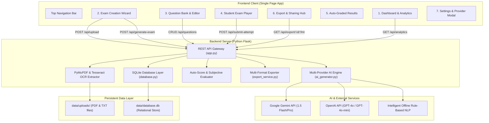
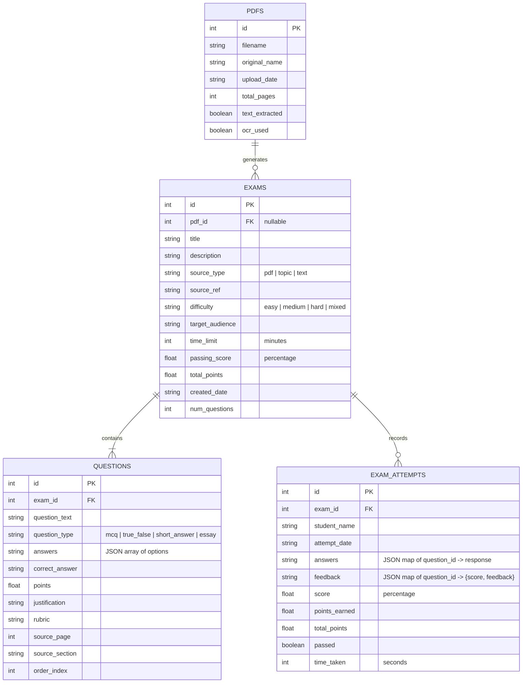

# StudyWise AI | Master Platform Documentation
*AI-Powered Exam Generation, Assessment, and Auto-Grading Suite*
*Modeled after [exam-generator.com](https://exam-generator.com/)*

---

## Table of Contents
1. [Executive Overview & Vision](#1-executive-overview--vision)
2. [System Architecture](#2-system-architecture)
3. [Core Features & User Workflows](#3-core-features--user-workflows)
   - [3.1 Multi-Source Content Ingestion](#31-multi-source-content-ingestion)
   - [3.2 Multi-Format Question Generation](#32-multi-format-question-generation)
   - [3.3 Question Bank & Live Editor](#33-question-bank--live-editor)
   - [3.4 Student Exam Player with Question Palette](#34-student-exam-player-with-question-palette)
   - [3.5 Smart Auto-Grading & AI Subjective Evaluation](#35-smart-auto-grading--ai-subjective-evaluation)
   - [3.6 Multi-Format Export Hub](#36-multi-format-export-hub)
4. [Complete REST API Reference](#4-complete-rest-api-reference)
5. [Database Architecture & Entity Relationship Diagram](#5-database-architecture--entity-relationship-diagram)
6. [AI Provider Engine & Offline Demo Mode](#6-ai-provider-engine--offline-demo-mode)
7. [Export Formats & LMS Compatibility Specifications](#7-export-formats--lms-compatibility-specifications)
8. [Installation, Setup & Deployment Guide](#8-installation-setup--deployment-guide)
9. [Troubleshooting & Frequently Asked Questions](#9-troubleshooting--frequently-asked-questions)

---

## 1. Executive Overview & Vision

**StudyWise AI** is a comprehensive educational assessment suite engineered to streamline the creation, customization, administration, auto-grading, and distribution of academic examinations. Modeled directly after the feature set and user experience of **[exam-generator.com](https://exam-generator.com/) (StudyWise AI)**, the platform replaces manual test writing with intelligent, pedagogically aligned AI workflows.

### Primary Goals:
- **Save Educator Time**: Convert textbooks, syllabus documents, lecture notes, or curriculum topics into ready-to-administer exams in seconds.
- **Support Diverse Question Formats**: Move beyond simple multiple choice to include True/False, Short Answer, and analytical Essay questions with scoring rubrics.
- **Empower Live Customization**: Provide educators with a Question Bank Editor to customize prompts, adjust point weightings, rewrite options, and regenerate questions using AI prompt engineering.
- **Realistic Student Testing Experience**: Offer an interactive, timed exam player featuring a numbered question palette, flagging capabilities, and real-time status tracking.
- **Intelligent Auto-Grading**: Combine deterministic scoring for objective questions with AI-assisted semantic rubric evaluation for subjective short answers and essays.
- **Universal Interoperability**: Export ready-to-print papers (Student & Teacher PDF/HTML), editable Word documents (`.docx`), Google Forms CSVs, and Moodle LMS GIFT packages.
- **Frictionless Zero-Setup Onboarding**: Include a high-quality offline rule-based demo engine so users can test the entire platform with zero API keys required.

---

## 2. System Architecture

The application adopts a decoupled client-server architecture with a Single Page Application (SPA) frontend communicating over REST with a lightweight, high-performance Python Flask backend.



---

## 3. Core Features & User Workflows

### 3.1 Multi-Source Content Ingestion
StudyWise AI accommodates three primary input modes:
1. **Document Upload (PDF / TXT)**:
   - PyMuPDF performs high-speed native digital text extraction.
   - Automatic fallback to **Tesseract OCR** for scanned pages or image-heavy handouts.
   - Generates an immediate pre-generation summary displaying total pages, word count, OCR status, and a content excerpt preview.
2. **Curriculum Topic / Prompt**:
   - Instructors can type a subject (e.g., *"Computer Networks: TCP/IP vs OSI Model"*, *"Organic Chemistry: Alkene Reactions"*).
   - The engine generates aligned assessment questions without requiring an uploaded file.
3. **Pasted Study Notes**:
   - Allows pasting raw lecture transcripts, syllabus outlines, or markdown study notes directly into the web interface.

### 3.2 Multi-Format Question Generation
The platform generates four distinct question types according to user-selected quantities:
- **Multiple Choice (MCQ)**: 4 distinct choices with exactly one mathematically or factually correct choice, accompanied by plausible distractors and pedagogical rationales.
- **True / False**: Conceptual assertions testing core principles.
- **Short Answer**: Questions requiring 1–3 sentence responses, accompanied by model answers and scoring criteria.
- **Essay / Analytical**: In-depth analytical prompts accompanied by a multi-point grading rubric (e.g. definitions, practical synthesis, critical evaluation).

### 3.3 Question Bank & Live Editor
Educators maintain complete editorial control before distributing exams:
- **Inline Text Editing**: Edit question prompts, choices, and explanations directly in place.
- **Change Correct Answer**: Radio buttons on MCQ and True/False cards enable re-assigning the correct choice.
- **Adjust Points & Marks**: Modify the point value of any question (default: 1.0 pt for MCQs/TF, 2.0 pts for Short Answer, 5.0 pts for Essay).
- **AI Regenerate**: Click **🪄 AI Regenerate** on any question card to provide targeted guidance (e.g. *"Make this harder"*, *"Focus on real-world coding examples"*).
- **Add Custom Question**: Modal allowing manual creation of proprietary questions.
- **Delete Question**: Removes questions and recalculates exam totals instantly.

### 3.4 Student Exam Player with Question Palette
The test-taking interface provides a distraction-free student experience:
- **Real-Time Countdown Timer**:
  - Normal state (neutral gray/dark).
  - Warning alert (turns amber/yellow at 5 minutes remaining).
  - Urgent alert (pulsing red at 2 minutes remaining).
  - Automatic submission upon timer expiration.
  - Supports untimed mode (counting upwards).
- **Question Palette Sidebar**:
  - Numbered circular badges (1..N) with live color feedback:
    - 🟩 **Green**: Answered
    - 🟦 **Blue**: Current question
    - 🟧 **Orange**: Flagged for review
    - ⬜ **Gray**: Unanswered
- **Safety Pre-Submission Confirmation**:
  - Clicking "Submit Exam" triggers a summary dialog listing answered, unanswered, and flagged questions before final submission.

### 3.5 Smart Auto-Grading & AI Subjective Evaluation
Upon submission, exams are graded via a dual-engine pipeline:
1. **Deterministic Objective Auto-Scoring**: Evaluates MCQs and True/False questions with 100% accuracy against recorded keys.
2. **AI Subjective Rubric Evaluation**: Uses Gemini / OpenAI / rubric keyword matching to grade short answers and essays, awarding numerical scores (0.0 to points) and constructive 1–2 sentence feedback.
3. **Visual Results Card**:
   - Conic-gradient radial percentage score gauge.
   - Dynamic **PASSED** or **NEEDS IMPROVEMENT** status banner based on the exam's passing grade.
   - Question-by-question breakdown showing candidate choices, correct choices, source page citations, and AI feedback.

### 3.6 Multi-Format Export Hub
The Export Hub enables downloading assessment materials in standard formats:
- **Student Exam Paper (PDF / Print)**: Formal layout with candidate name, roll number, instructions, bubble checkboxes, and ruled answer lines. No solutions shown.
- **Teacher Solution Key (PDF / Print)**: Complete answer key with highlighted choices in bold green, full explanations, rubrics, and source page citations.
- **Microsoft Word (.docx)**: Editable Word documents for both student tests and teacher keys.
- **Google Forms CSV**: Ready-to-import CSV file for Google Forms / Quiz spreadsheet automation.
- **Moodle LMS (GIFT)**: Official GIFT format for direct question bank import.
- **Portable JSON**: Complete exam data backup.

---

## 4. Complete REST API Reference

Base URL: `http://127.0.0.1:5000/api`

### 4.1 System & Diagnostics

#### `GET /api/health`
Health check endpoint.
- **Response**: `200 OK`
```json
{
  "status": "ok",
  "message": "StudyWise Exam Generator API is running",
  "timestamp": "2026-11-07T10:00:00.000000"
}
```

#### `GET /api/settings`
Retrieves the status of configured AI providers.
- **Response**: `200 OK`
```json
{
  "success": true,
  "providers": {
    "demo": { "available": true, "default": true, "label": "Demo / Offline Engine" },
    "gemini": { "available": true, "default_model": "gemini-1.5-flash", "label": "Google Gemini AI" },
    "openai": { "available": false, "default_model": "gpt-4o-mini", "label": "OpenAI" }
  }
}
```

#### `POST /api/settings`
Tests an AI provider connection and API key.
- **Request Body**:
```json
{
  "provider": "gemini",
  "api_key": "AIzaSy..."
}
```
- **Response**: `200 OK` or `400 Bad Request`
```json
{
  "success": true,
  "message": "Connection test to GEMINI successful! Generated sample question."
}
```

#### `GET /api/analytics`
Fetches high-level metrics for the dashboard view.
- **Response**: `200 OK`
```json
{
  "success": true,
  "summary": {
    "total_exams": 5,
    "total_questions": 42,
    "total_attempts": 8,
    "avg_score": 78.5,
    "total_pdfs": 3
  },
  "recent_exams": [ ... ],
  "recent_attempts": [ ... ]
}
```

---

### 4.2 Document Ingestion

#### `POST /api/upload`
Uploads a PDF or TXT file and extracts textual content.
- **Content-Type**: `multipart/form-data`
- **Form Data**: `file` (binary document)
- **Response**: `200 OK`
```json
{
  "success": true,
  "pdf": {
    "id": 1,
    "filename": "uuid_syllabus.pdf",
    "original_name": "syllabus.pdf",
    "upload_date": "2026-11-07T10:00:00",
    "total_pages": 12,
    "text_extracted": true,
    "ocr_used": false
  },
  "summary": {
    "total_pages": 12,
    "total_words": 3450,
    "ocr_used": false
  },
  "preview_text": "Course Outline: Introduction to Algorithms..."
}
```

---

### 4.3 Exam Generation & Management

#### `POST /api/generate-exam`
Generates a complete examination from PDF, text, or topic prompt.
- **Request Body**:
```json
{
  "source_type": "pdf",           // "pdf" | "topic" | "text"
  "pdf_id": 1,                     // Required if source_type == "pdf"
  "topic": "",                     // Required if source_type == "topic"
  "raw_text": "",                  // Required if source_type == "text"
  "title": "Algorithms Midterm",
  "difficulty": "medium",          // "easy" | "medium" | "hard" | "mixed"
  "target_audience": "Undergraduate",
  "time_limit": 45,                // Minutes (0 = untimed)
  "passing_score": 75.0,           // Percentage
  "question_config": {
    "mcq": 5,
    "true_false": 3,
    "short_answer": 2,
    "essay": 1
  },
  "provider": "gemini",            // "gemini" | "openai" | "demo"
  "api_key": ""                    // Optional user API key override
}
```
- **Response**: `200 OK`
```json
{
  "success": true,
  "exam": {
    "id": 1,
    "title": "Algorithms Midterm",
    "difficulty": "medium",
    "num_questions": 11,
    "total_points": 18.0,
    "time_limit": 45,
    "passing_score": 75.0,
    "questions": [ ... ]
  }
}
```

#### `GET /api/exams`
Lists all generated exams with summary metadata.
- **Response**: `200 OK`

#### `GET /api/exam/<int:exam_id>`
Retrieves an exam with all child question records.
- **Response**: `200 OK` or `404 Not Found`

#### `PUT /api/exam/<int:exam_id>`
Updates exam metadata (title, time limit, passing score, difficulty).
- **Request Body**:
```json
{
  "title": "Updated Midterm Exam",
  "time_limit": 60,
  "passing_score": 70.0
}
```

#### `DELETE /api/exam/<int:exam_id>`
Deletes an exam, its questions, and all related student attempt logs.
- **Response**: `200 OK`

---

### 4.4 Question Bank Operations

#### `POST /api/exam/<int:exam_id>/questions`
Manually adds a custom question to an existing exam.
- **Request Body**:
```json
{
  "question_text": "What is the time complexity of quicksort in the worst case?",
  "question_type": "mcq",
  "answers": [
    { "text": "O(n log n)", "is_correct": false },
    { "text": "O(n^2)", "is_correct": true },
    { "text": "O(n)", "is_correct": false },
    { "text": "O(1)", "is_correct": false }
  ],
  "correct_answer": "O(n^2)",
  "points": 1.0,
  "justification": "Quicksort degrades to O(n^2) when poor pivot selection occurs.",
  "source_page": 45
}
```

#### `PUT /api/questions/<int:question_id>`
Updates question content, option choices, points, or explanation.
- **Request Body**: Fields to update (`question_text`, `answers`, `points`, etc.).

#### `DELETE /api/questions/<int:question_id>`
Deletes a question and automatically recalculates exam metrics.

#### `POST /api/questions/<int:question_id>/regenerate`
Regenerates an individual question using AI prompt instructions.
- **Request Body**:
```json
{
  "instruction": "Make the question harder and focus on practical corner cases",
  "provider": "gemini",
  "api_key": ""
}
```

---

### 4.5 Exam Taking & Auto-Grading

#### `POST /api/submit-attempt`
Submits an exam attempt for automated scoring and AI rubric evaluation.
- **Request Body**:
```json
{
  "exam_id": 1,
  "student_name": "Alex Mercer",
  "time_taken": 1420,              // Seconds
  "answers": {
    "1": 1,                        // MCQ: selected option index
    "2": 0,                        // True/False: selected option index
    "3": "Binary search divides the search space in half each step.", // Short answer text
    "4": "In relational design, normalization minimizes redundancy..." // Essay text
  },
  "provider": "gemini",
  "api_key": ""
}
```
- **Response**: `200 OK`
```json
{
  "success": true,
  "score": 85.0,                   // Percentage
  "points_earned": 15.3,
  "total_points": 18.0,
  "passed": true,
  "feedback": {
    "3": { "score": 2.0, "feedback": "Accurate definition of logarithmic reduction." },
    "4": { "score": 4.5, "feedback": "Comprehensive synthesis covering 1NF through BCNF." }
  },
  "attempt": { ... }
}
```

#### `GET /api/attempts/<int:exam_id>`
Retrieves historical attempts for a given exam.

---

### 4.6 Multi-Format Exports

#### `GET /api/export/<int:exam_id>/<format_type>`
Streams or downloads assessment documents in the specified format:
- `format_type=html?type=student`: Clean printable student examination paper.
- `format_type=html?type=teacher`: Comprehensive teacher solution key with answers.
- `format_type=docx?type=student`: Microsoft Word `.docx` student test paper.
- `format_type=docx?type=teacher`: Microsoft Word `.docx` teacher solution key.
- `format_type=gift`: Standard Moodle LMS GIFT file (`attachment; filename="exam_moodle.gift.txt"`).
- `format_type=google-forms`: Google Forms importable CSV (`attachment; filename="exam_google_forms.csv"`).
- `format_type=json`: Full structured JSON backup.

---

## 5. Database Architecture & Entity Relationship Diagram

StudyWise AI utilizes an SQLite relational database with cascading foreign keys and dynamic schema auto-migration.



---

## 6. AI Provider Engine & Offline Demo Mode

StudyWise AI features a flexible multi-provider architecture:

### 6.1 Google Gemini AI Integration
- **Models**: `gemini-1.5-flash` (recommended default for speed and accuracy), `gemini-1.5-pro`.
- **Protocol**: Direct REST API call to `https://generativelanguage.googleapis.com/v1beta/models/{model}:generateContent`.
- **Format**: Structured prompt with `responseMimeType: "application/json"`.
- **Environment Variable**: `GEMINI_API_KEY` (or entered via UI Settings).

### 6.2 OpenAI Integration
- **Models**: `gpt-4o-mini`, `gpt-4o`, `gpt-3.5-turbo`.
- **Protocol**: Chat completion REST API endpoint `/chat/completions` with JSON mode (`response_format: {"type": "json_object"}`).
- **Custom Base URLs**: Compatible with OpenAI-compatible inference servers (e.g., Local Ollama `/v1`, OpenRouter, Groq).
- **Environment Variable**: `OPENAI_API_KEY` (or entered via UI Settings).

### 6.3 Intelligent Offline Demo Engine
- Operates when no API keys are provided or when `provider="demo"` is selected.
- Analyzes document sentences, terminology, and definitions via rule-based NLP.
- Formulates MCQs with plausible vocabulary distractors, True/False assertions, short answer prompts, and essays.
- Ensures the platform is testable and functional immediately after cloning.

---

## 7. Export Formats & LMS Compatibility Specifications

### 7.1 Moodle LMS (GIFT Syntax)
Moodle GIFT format allows one-click import into Moodle Question Banks:
```gift
// Exam: Full Stack Web Development
// Generated by StudyWise AI (exam-generator.com)

::Q1_mcq:: What is the primary role of Flask-CORS? {
  =Enable Cross-Origin Resource Sharing # CORS enables safe cross-origin AJAX requests.
  ~Database compression
  ~Client-side routing
  ~CSS preprocessor
}

::Q2_true_false:: Python supports structured programming. {TRUE#The source confirms structured programming is fully supported.}

::Q3_short_answer:: Explain the role of virtual environments. {=Isolated Python dependencies#Isolates package versions per project.}

::Q4_essay:: Discuss the architectural trade-offs between monolithic and microservices designs. {}
```

### 7.2 Google Forms CSV Format
Exported CSV files can be imported into Google Forms quiz builders:
| Question | Question Type | Option 1 | Option 2 | Option 3 | Option 4 | Correct Answer | Points | Explanation |
| :--- | :--- | :--- | :--- | :--- | :--- | :--- | :--- | :--- |
| What is encapsulation? | mcq | Bundling data and methods | Multiple inheritance | Direct pointer access | Global state | Bundling data and methods | 1.0 | Encapsulation bundles data with operations. |
| Python is compiled directly to machine code. | true_false | True | False | | | False | 1.0 | Python compiles to bytecode executed by PVM. |

---

## 8. Installation, Setup & Deployment Guide

### 8.1 System Prerequisites
- **Python**: Version 3.8 to 3.15
- **Tesseract OCR**: Required for scanned PDF text extraction
  - **Ubuntu / Debian**: `sudo apt-get install tesseract-ocr`
  - **Fedora / RHEL**: `sudo dnf install tesseract`
  - **macOS**: `brew install tesseract`
  - **Windows**: Download from [UB-Mannheim/tesseract](https://github.com/UB-Mannheim/tesseract/wiki)

### 8.2 Installation Steps
```bash
# 1. Clone repository
git clone <repository-url>
cd PDF

# 2. Install Python dependencies
pip install -r backend/requirements.txt
```

### 8.3 Starting the Application
- **Linux / macOS**:
  ```bash
  ./start.sh
  ```
- **Windows (Command Prompt / PowerShell)**:
  ```cmd
  start.bat
  # or in PowerShell: .\start.ps1
  ```
- **Manual Launch**:
  ```bash
  cd backend
  python3 app.py
  ```
Open your browser at **`http://127.0.0.1:5000/`**.

### 8.4 Production Deployment (Gunicorn & Nginx)
For high-concurrency production deployments:
```bash
# Install Gunicorn
pip install gunicorn

# Run Gunicorn with 4 workers from the backend directory
cd backend
gunicorn -w 4 -b 127.0.0.1:5000 app:app
```

---

## 9. Troubleshooting & Frequently Asked Questions

### Q: Why does question generation work without setting an API key?
**A**: StudyWise AI includes a built-in **Offline Demo Engine**. If neither `GEMINI_API_KEY` nor `OPENAI_API_KEY` is set, the system uses rule-based NLP extraction to generate realistic questions from your content.

### Q: How do I enable Google Gemini 1.5 Flash?
**A**: 
1. Get a free API key from [Google AI Studio](https://aistudio.google.com/).
2. Click the **⚙️ Settings** icon in the StudyWise navigation bar.
3. Select **Google Gemini AI**, paste your key, click **Test Connection**, and click **Save Preferences**.
*(Alternatively, set `export GEMINI_API_KEY="AIzaSy..."` in your terminal.)*

### Q: How do I export an exam directly to PDF?
**A**: In the **Export Hub**, click **🖨️ View & Print PDF** on either the Student Exam Paper or Teacher Solution Key card. An in-browser preview will open; click the top **Print / Save as PDF** button (or press `Ctrl+P` / `Cmd+P`) to save a formatted PDF.

### Q: Where are uploaded PDFs and exams stored?
**A**: 
- Uploaded files are stored in `data/uploads/`.
- All exams, questions, and attempt records are stored in `data/database.db` (SQLite).
